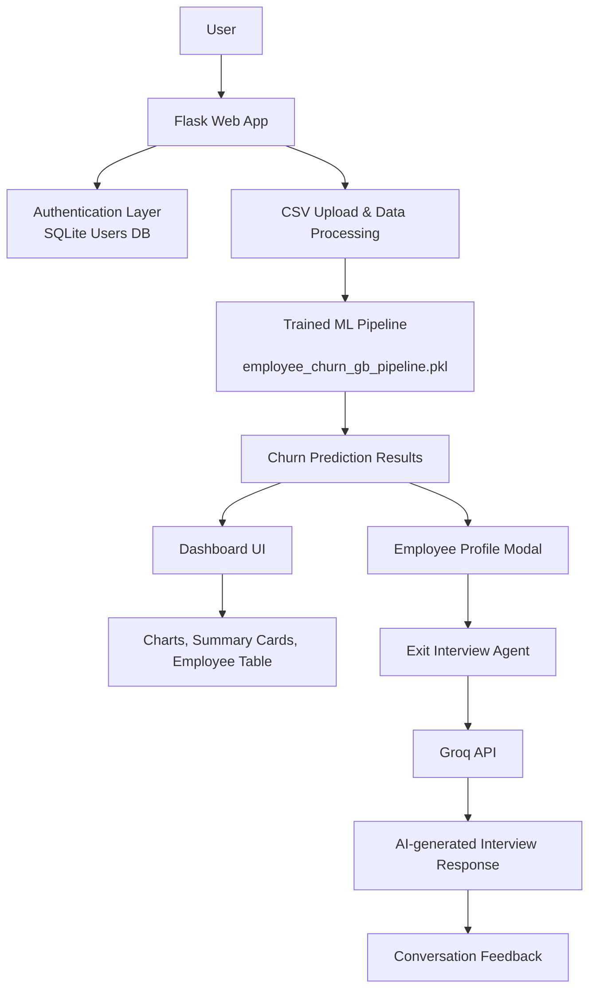

# ChurnGuard

ChurnGuard is a smart employee retention and churn analysis web application built with Flask. It helps HR teams and decision-makers identify employees who are at risk of leaving, understand the main reasons behind churn, and explore retention strategies through an interactive dashboard and an AI-powered exit interview experience.

## Main Objective

The primary goal of ChurnGuard is to make employee attrition easier to understand and act on. Instead of relying only on raw HR spreadsheets, the project turns employee data into:

- churn probability scores,
- risk categories such as Low, Medium, and High,
- visual analytics for departments and workplace factors,
- detailed employee profiles for follow-up,
- and a simulated exit interview experience powered by AI.

In short, ChurnGuard helps HR teams move from reactive reporting to proactive retention planning.

## What the Project Does

ChurnGuard combines machine learning, web development, and conversational AI in one application.

### 1. Employee Churn Prediction
The system uses a pre-trained machine learning pipeline stored in the project as a pickle file. When a user uploads a CSV file containing employee information, the app:

- prepares the data,
- runs the model to predict churn probability,
- classifies each employee into a risk bucket,
- and returns a structured result for the dashboard.

### 2. Interactive HR Dashboard
After prediction, the dashboard displays:

- total employee count,
- high, medium, and low risk counts,
- average churn probability,
- charts for department risk distribution,
- overtime impact,
- job satisfaction trends,
- work-life balance insights,
- and a searchable employee table.

### 3. Employee Profile Review
HR users can inspect individual employee records in a profile modal to understand important factors such as:

- age,
- department,
- role,
- monthly income,
- overtime status,
- satisfaction levels,
- work-life balance,
- experience history,
- and distance from home.

### 4. Exit Interview Agent
The app also includes an AI-driven exit interview feature. A selected employee profile is converted into a persona prompt, and the system uses the Groq API to simulate an HR conversation. This allows HR teams to practice difficult conversations and gather better retention insights.

## Project Workflow

Here is the typical flow of the application:

1. A user signs up or logs in.
2. The user lands on the welcome page and then opens the main dashboard.
3. The user uploads an employee dataset in CSV format.
4. The backend reads the data and predicts churn risk for each employee.
5. The dashboard renders summary cards, charts, and a detailed employee directory.
6. The user can click an employee row to view their profile.
7. The user can start an exit interview conversation for that employee.
8. The AI agent responds in character, simulating a realistic exit interview discussion.

## Core Features

- Secure user authentication using SQLite
- Protected routes for dashboard and prediction functionality
- CSV upload support for employee datasets
- Machine learning-based churn prediction
- Risk level classification
- Dynamic charts and analytics
- Search and filter options in the employee directory
- Employee profile modal with detailed attributes
- AI-powered exit interview simulation
- Local session management for interview conversations

## Architecture Diagram



## Tech Stack

### Backend
- Python
- Flask
- pandas
- numpy
- joblib
- sqlite3
- python-dotenv
- requests

### Frontend
- HTML
- CSS
- JavaScript
- Chart.js

### Machine Learning
- Pre-trained Gradient Boosting pipeline stored in a pickle file

### AI Integration
- Groq API for conversational response generation

## Project Structure

```text
.
├── app.py                  # Main Flask application and backend logic
├── employee_churn_gb_pipeline.pkl  # Trained churn prediction model
├── users.db                # SQLite database for authentication
├── WA_Fn-UseC_-HR-Employee-Attrition.csv  # Sample HR dataset
├── dashboard/              # Dashboard-related assets or supporting files
├── static/                 # CSS and JavaScript assets
├── templates/              # HTML templates for welcome, login, signup, and dashboard
└── README.md               # Project documentation
```

## Required Input Data

The application is designed to work best with a CSV file that contains employee attributes similar to the provided HR attrition dataset. The model expects fields such as:

- Age
- Department
- JobRole
- MonthlyIncome
- OverTime
- JobSatisfaction
- EnvironmentSatisfaction
- WorkLifeBalance
- YearsAtCompany
- YearsInCurrentRole
- Education
- BusinessTravel
- and related HR features

If the dataset includes an Attrition column, it can be used as a reference value during prediction.

## Setup Instructions

### 1. Clone or open the project
Open the project folder in your preferred Python environment.

### 2. Create a virtual environment
```bash
python -m venv venv
venv\Scripts\activate
```

### 3. Install dependencies
```bash
pip install flask pandas numpy joblib python-dotenv requests
```

### 4. Configure environment variables
Create a `.env` file in the project root if needed and add your Groq API key:

```env
GROQ_API_KEY=your_api_key_here
```

> The dashboard itself can run without the API key, but the exit interview feature requires it to work.

### 5. Run the application
```bash
python app.py
```

Then open:

- http://localhost:5000/welcome for the landing page
- http://localhost:5000/ for the dashboard after login

## Usage Guide

### Sign Up / Login
Create an account to access the protected dashboard. Authentication is handled using a local SQLite database.

### Upload Dataset
After logging in, upload a CSV file containing employee data. The app will process the file and generate predictions.

### Explore Insights
Use the dashboard to review churn risk trends, compare departments, and inspect individual employees.

### Start an Exit Interview
From an employee profile, start an interview session and interact with the AI-based HR agent.

## Notes

- The app is intended for demonstration and HR analytics use cases.
- The model is loaded from the included pickle file, so no additional training step is required.
- The UI is designed for a clean, modern experience and is optimized for local web use.

## Summary

ChurnGuard is a practical full-stack project that combines machine learning, analytics, and AI conversation to help organizations better understand and respond to employee attrition. It is especially useful for HR professionals who want a simple, interactive way to analyze employee risk patterns and simulate retention conversations.
